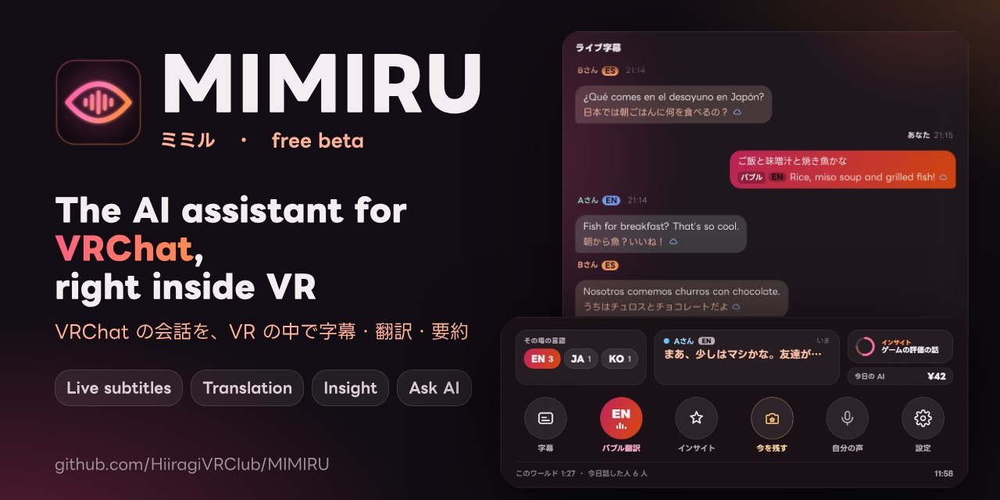
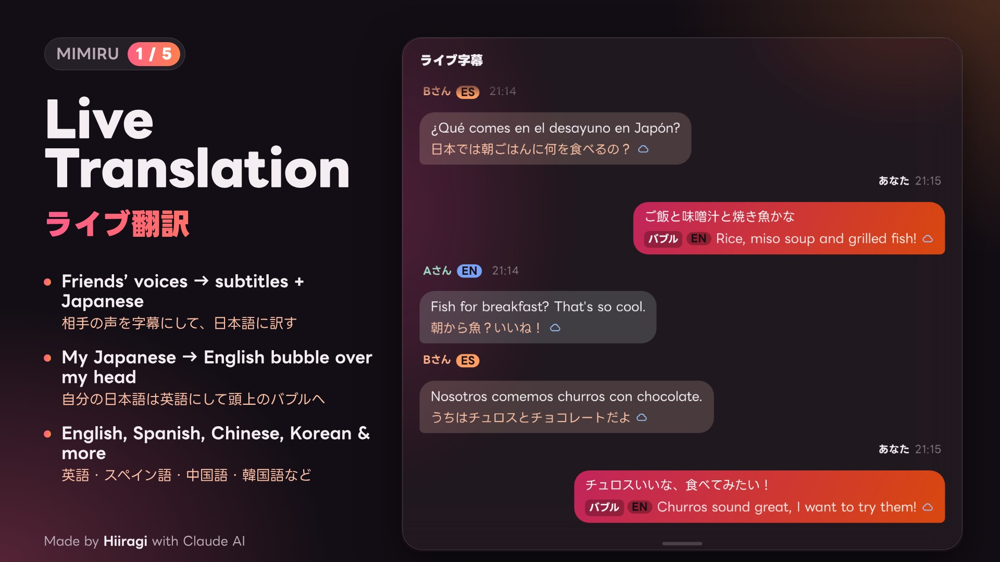
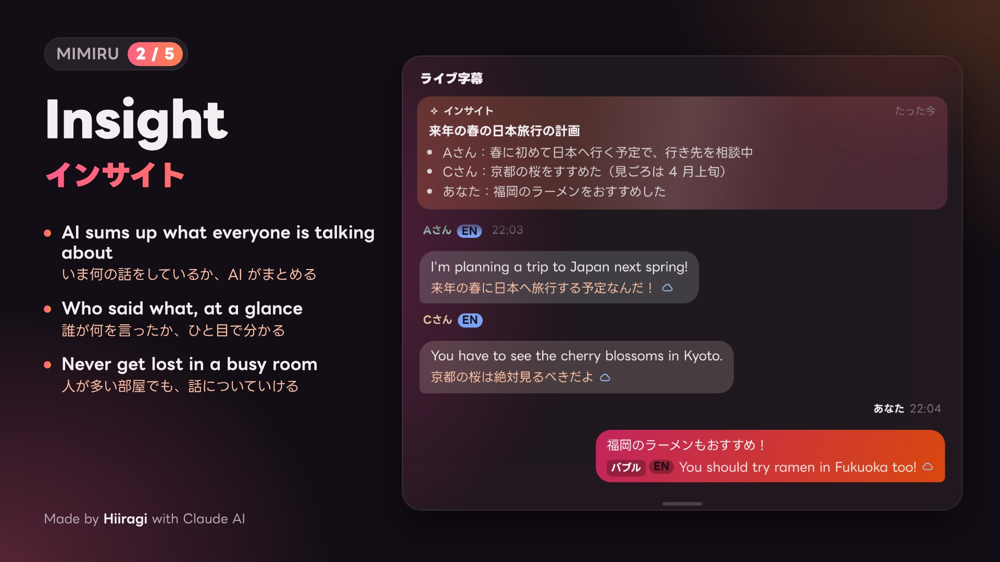
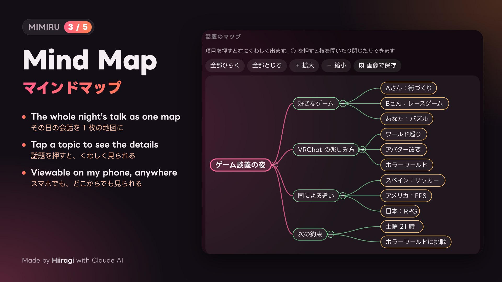
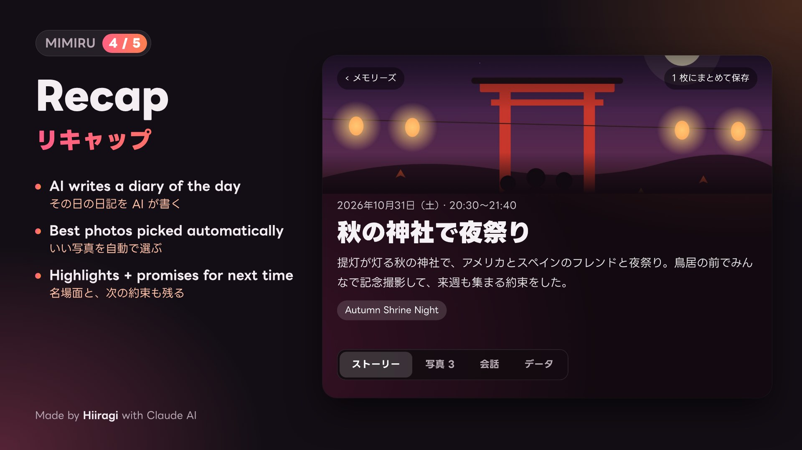
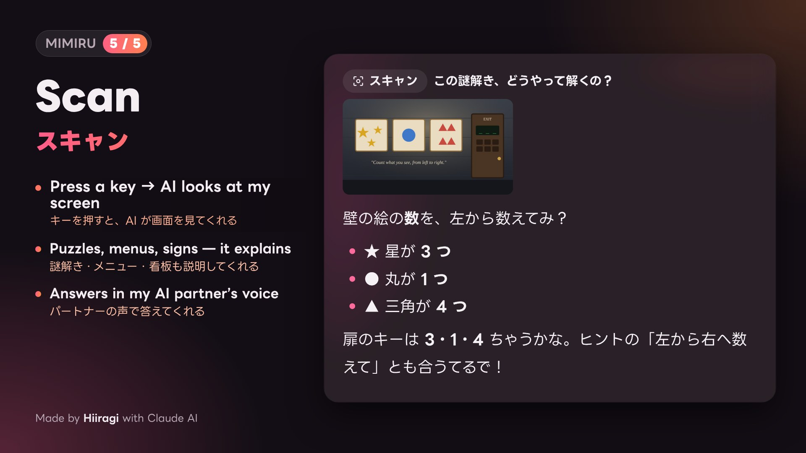

[日本語](README.md) | **English**

# MIMIRU (beta)

**The AI assistant for VRChat, right inside VR** — free beta for Windows.

> **The app's screens are in Japanese for now.** English UI is planned next (your own language for subtitles, translations and answers).
> Found a bug? Please tell us in [Issues](https://github.com/HiiragiVRClub/MIMIRU/issues/new/choose).
> **[Download (Releases)](https://github.com/HiiragiVRClub/MIMIRU/releases/latest)**

## What it does

### Live translation & bubble translation
Turns your friends' voices into subtitles and translates them. A fast on-PC translation shows instantly, then a natural AI translation replaces it about a second later. Your own voice is translated and shown above your head (VRChat chatbox).

### Insight
AI sums up what everyone is talking about and who said what — never get lost in a busy room.

### Mind map & recap
The whole night's talk as one map, plus an AI-written diary with the best photos picked automatically (kept on your PC).

### Scan & ask
Press a key and the AI looks at your screen — puzzles, menus, signs. You can also capture what you see in VR and ask about it.

### Works inside VR
Look at your left wrist to open the toolbar, and place the main panel anywhere in your space (SteamVR; works with Quest + Virtual Desktop).

## Requirements
- Windows 10 / 11 (64-bit)
- **An NVIDIA GPU is recommended** (it also runs without one, but subtitles are slower and less accurate)
- An AI API key (one of Claude, OpenAI, Gemini or DeepSeek) for the AI features — you pay the provider for what you use
- SteamVR, if you use it in VR
- About 10 GB of free space (speech recognition and translation models are downloaded on first start)

## Install
1. Download the latest `MIMIRU_v….zip` from **Releases**
2. Extract it anywhere (e.g. `D:\MIMIRU`)
3. Double-click **start.bat** — on a new PC a setup window installs everything it needs (10–30 min). If Windows SmartScreen appears, click "More info" → "Run anyway"
4. The first-run guide asks for your AI key and which features to use

## Safety & privacy
- **MIMIRU does not touch VRChat's anti-cheat (EAC).** It only uses per-app audio capture, VRChat's official OSC, reading the log file, screen capture and SteamVR's official APIs — no memory reading/writing, no mods, no game file changes.
- Subtitles, conversation logs and photos stay on your PC (audio is never saved). AI features send the relevant text/images to the AI provider you chose.
- "MIMIRU Quality Program": once a day it shares only which features were used for how long and where errors happened (no subtitles, questions, names or keys). You can turn it off in settings.

## Need help?
- Settings → General → "困ったとき" (Troubleshooting) → "記録をまとめて書き出す" creates one zip of logs (API keys are masked).
- **Issues are public** — please don't attach that zip there; send it to the author directly.

## License
MIMIRU is free to use but not open source ([LICENSE.txt](LICENSE.txt)). Third-party components and models: [THIRD_PARTY.md](THIRD_PARTY.md).

© HiiragiVRClub
